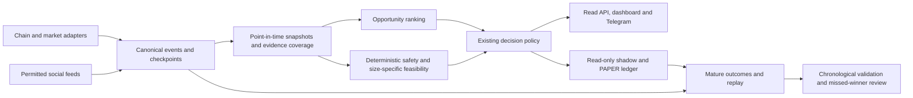

# MemeRadar Early Alpha Intelligence Implementation Plan

> **For implementers** — Execute the milestones in dependency order using the repository's normal verification workflow. Track each acceptance item against the commit, dataset and configuration that produced its evidence.

**Date** — 2026-11-25

**Status** — Proposed research extension

**Goal** — Detect and explain early token opportunities, measure whether the signals anticipate 10x–100x moves, and determine which opportunities remain viable after risk, liquidity, delay and execution costs.

**Architecture** — Extend MemeRadar's Python modular monolith and existing evidence pipeline. Keep opportunity ranking, deterministic risk decisions and execution feasibility independently visible. Reuse the same normalized events for live ingestion, backfill and replay.

**Stack** — Existing Python packages, FastAPI, PostgreSQL/Alembic, Redis, Next.js and Telegram. LightGBM and CatBoost are optional offline comparison candidates.

**Research brief** — User-supplied “MemeRadar — 10x–100x potensiallı tokenlərin erkən aşkarlanması üçün araşdırma,” dated 2026-11-25. Its 15 modules and M0–M11 milestones are mapped below.

**Repository precedence** — [AGENTS.md](../../../AGENTS.md), [core roadmap](../../ROADMAP.md), [checkpoint and newer entries](../../STATUS.md), [scoring and risk policy](../../SCORING_AND_RISK.md), and [November early-radar review](../../audits/EARLY_RADAR_CRITICAL_REVIEW_2026-11-19.md).

## 1. Starting point and scope

The inspected branch is `claude/exciting-brahmagupta-0k7pds` at `6b091b4`. The repository has Solana launch and partial trade-tape ingestion, forward evidence collection, a 72-hour lifecycle watch, versioned scoring and risk, creator/wallet graphs, narrative matching, historical validation, replay, calibration, PAPER execution, and operator surfaces. The 2026-11-19 review records corrected DEX first-seen intervals, Jupiter impact units, unique-mint sample counts and convex-exit policy ranking. Use these as regression cases. [README](../../../README.md), [merged review](../../audits/EARLY_RADAR_CRITICAL_REVIEW_2026-11-19.md).

Earlier local verification, bounded live reads and PostgreSQL readiness are different evidence scopes. The repository records current-source PostgreSQL/restart and real Telegram acceptance as open, source/subscription completeness as unknown, and independent alpha as unproven. M0 must recheck those items on the actual implementation checkout. Robinhood's provider seam exists and its verified launchpad registry is empty in this checkout. [Status](../../STATUS.md), [production readiness](../../PRODUCTION_READINESS.md), [Robinhood adapter](../../../packages/providers/src/memeradar_providers/robinhood.py).

### Global constraints

- Preserve `ANALYSIS_ONLY=true`, `PAPER_TRADING=true`, `MANUAL_EXECUTION=false` and `AUTO_EXECUTION=false`. PAPER worker activation follows existing opt-in and portfolio rules. Scope covers read-only observations, replay, simulated execution and advisory alerts.
- Solana Pump.fun → PumpSwap is the first measured vertical slice. Robinhood is a separately verified and calibrated extension. Preserve the existing BNB and other chain routes.
- Use canonical chain/network, asset and venue identities. Solana registry routing requires verified program plus discriminator/tag. EVM routing requires the verified chain, contract and event scope. Maintain finality and rollback semantics.
- Evaluate only evidence available at the decision cutoff. Preserve provenance, freshness, commitment, evidence references, reason codes and parser/feature/risk/strategy versions. Missing evidence is `UNKNOWN`.
- Keep critical sellability, contract and evidence-quality gates deterministic. An experimental rank, model, external label or LLM output cannot lift a hard block or independently authorize `ENTRY_READY`.
- Treat current provider plans, dataset permissions and venue coverage as adoption checks. Register the upstream revision and terms before ingesting or adapting material. Keep credentials and private raw content out of logs, exports and fixtures.

### Review focus

- PostgreSQL commit/restart races, duplicate deliveries and worker claims → M0, M9, M10.
- Unresolved slots, out-of-order data, invalid program attribution and EVM removed logs → M5, R1.
- Target leakage through later wallet reputation, duplicate assets and maturity timing → M1–M4, M7–M8.
- Large market-cap marks with missing routes, malformed units or insufficient depth → M2, M6, M8–M9.
- Copycat narratives, paid boosts, false-positive graph links and incomplete source evidence → M3–M4, M6, M10–M11.

## 2. Dependencies and ownership

| Milestone | Primary owner | Prerequisites | Output |
| --- | --- | --- | --- |
| M0 — Runtime and PostgreSQL | Platform | Current checkout | Current-source runtime evidence and tracked blockers |
| M1 — Historical data and quality | Data engineering | Canonical schema, M0 baseline | Versioned launch inventory, cohort manifest and exclusion ledger |
| M2 — Extreme Winner DNA | Quant research | M1 pilot | Decision-time feature and outcome specification, baseline results |
| M3 — Wallet and creator intelligence | Backend/data | M1 identity and time contract | Point-in-time graph snapshots and copyability evidence |
| M4 — Pre-launch narrative | Backend/data | M1 time contract, permitted feeds | Narrative watchlist, token matches and lead–lag report |
| M5 — First 120 seconds and lifecycle tape | Ingestion | M0 baseline, M1 event contract | Verified windows and Pump.fun → PumpSwap continuity |
| M6 — Organic demand, sellability and rug risk | Backend/risk | M3 and M5 contracts | Explainable independent risk and depth evidence |
| M7 — Baselines and model bake-off | Quant research | M2 plus available M3–M6 inputs | Frozen candidate model and calibration report |
| M8 — Walk-forward and fills | Quant research | M5–M7, mature cohorts | Blind holdout and cost-adjusted results |
| M9 — Shadow and PAPER | Platform/quant | M0 runtime acceptance, M8 evaluation | 7-day stability and 30-day forward evidence |
| M10 — API, dashboard and Telegram | Product/backend | M0 runtime, stable M6/M8 evidence contract | Operator views, alert and receipt evidence |
| M11 — Missed-winner feedback | Data/quant | M1 denominator, M8/M9 outcomes | Reconciled misses, incident owners and follow-up experiments |
| R1 — Robinhood Chain | Ingestion/risk | M0 and shared contracts, verified chain/venue evidence | Separate chain readiness and calibration artifacts |

Start M5 protocol work during M1 inventory work. Run M3 and M4 as independent feature tracks. Start the authorized M9 capture as soon as M0 operational acceptance and the M5 recording contract are ready. Start frozen formal evaluation after M8, using only prospective evidence from the frozen run or a prospectively recorded, untouched period. Build M10 with fixtures while those outcomes mature. R1 can validate adapters in parallel with M7–M9 once the shared contracts are stable.

Planning estimate for one experienced engineer with part-time quantitative review is **8–12 engineering weeks**, with a separate forward evidence clock of at least **30 days after the evaluation policy freezes**, plus the last label's 72-hour maturation period. Provider access, coverage gaps and sparse tail outcomes can extend acceptance. Estimates and candidate thresholds in this plan are proposed defaults.

## 3. Shared architecture and evidence contracts

The following names describe logical records. Adapt existing types and tables before proposing a migration.

| Record | Key and payload | Acceptance rule |
| --- | --- | --- |
| Canonical event | Chain/network, event coordinates and event kind, asset/venue, `occurred_at`, `observed_at`, `ingested_at`, source references, commitment and parser version | Primary event ID deduplicates provider overlap. Source observations remain distinct. Replays preserve original availability or declare its reconstruction class. |
| Decision snapshot | Asset, venue or cross-venue scope, trigger, decision time, fixed window bounds, versions, configuration hash, channel coverage | For runtime-parity replay, the event must occur within the window and be observed and durably available by decision time. Any weaker reconstruction is labeled as such. Preserve past decisions when late evidence arrives. |
| Graph or narrative snapshot | Entity or cluster ID, as-of time, source/platform scope, confidence, evidence references, version | A later merge, funding edge or classification only affects future snapshots. |
| Outcome | Asset, decision ID, horizon, price semantics, size, quote currency, resolved time, evidence class, censor reason and assumption hash | Store market mark, quote-backed sellable peak and simulated-policy outcome independently. An absent quote, unresolved gap or immature horizon has a reason. |
| Decision explanation | Score, risk status, quote size/time/quality, freshness, top positive/negative drivers, reason codes, data and model versions | API, dashboard and Telegram derive from one persisted decision. Research probability carries explicit calibration status and horizon. |

Persist additive fields with compatibility defaults only where they have a clear historical meaning. Validate migration and reader compatibility on older records carrying missing values. Use UTC for data cutoffs and preserve source timestamps. Store bulky licensed datasets outside Git and record relative artifact identifiers and SHA-256 digests in versioned manifests.

Path aliases used below are repository-relative: `APP` = `packages/application/src/memeradar_application/`, `DOMAIN` = `packages/domain/src/memeradar_domain/`, `PROVIDERS` = `packages/providers/src/memeradar_providers/`, `DB` = `packages/persistence/src/memeradar_persistence/`, `WORKER` = `apps/worker/src/memeradar_worker/`, `API` = `apps/api/src/memeradar_api/`, `WEB` = `apps/web/src/app/`. Slash-separated file references under these aliases are existing integration points unless marked proposed.

## 4. Implementation milestones

### M0 — Restore current-source runtime and PostgreSQL acceptance

**Touchpoints** — `Makefile`, `infra/compose/docker-compose.yml`, `infra/alembic/versions/`, `WORKER/main.py`, `API/health.py`, `docs/STATUS.md`, `docs/RUNBOOKS/OPERATIONS.md`.

- [ ] Record source SHA, branch, dependency versions, protected-mode values and artifact digests. Inspect the current PostgreSQL, Redis and Compose prerequisites without printing connection secrets. Preserve the initial checkout and any operator data.
- [ ] Run `make verify` and `make migration-check`. Record the migration graph check as a separate result. In an isolated PostgreSQL database, test a fresh upgrade and the previous deployed schema → head upgrade. Confirm the PostgreSQL revision at head and run `make integration-test` with `MEMERADAR_TEST_DATABASE_URL`. A skipped suite is an open acceptance item.
- [ ] Re-run `tests/integration/test_early_runtime_persistence.py`, `test_stream_persistence_postgres.py`, `test_checkpoint_concurrency_postgres.py`, `test_paper_persistence_postgres.py` and `test_telegram_worker_path.py` under the same source. Prove restart/resume after commit and before acknowledgement, duplicate replays, overlapping claims, cursor recovery and backlog draining. Verify one durable decision and outbox entry for a duplicated fixture.
- [ ] Drill database and Redis interruptions with bounded local traffic. Check recovery, readiness reporting, backup/restore to a disposable database and API/worker health. Record stream gaps, processing latency, queue delay and persistence failures. Keep provider, browser and delivery evidence separately identified in the ledger.
- [ ] Update `docs/STATUS.md` with commands, exit codes, source/config identities, skips and remediation owners.

**Exit evidence** — A durable PostgreSQL path through ingest → snapshot → decision → outbox with a successful restart drill and zero duplicate committed effects. Local findings can advance fixture work while external blockers remain open.

### M1 — Build a trustworthy historical launch cohort

**Touchpoints** — `APP/historical_dataset.py`, `scripts/historical_dataset.py`, `scripts/reconcile_pumpfun_launches.py`, `fixtures/research/historical_real_dataset.schema.json`, `tests/unit/test_historical_dataset.py`.

- [ ] Reconcile finalized, verified launch records across fixed slots and time buckets using the canonical provider path plus an independent inventory. Include all observed verified launches in each bounded interval, including no-trade, non-graduating, inactive and failed tokens. Keep unresolved slots and unmatched identities in the coverage ledger. Define the scope before reporting recall.
- [ ] Record per input its pinned revision or export version, artifact hash, code and data terms, time range, chain/venue, sampling frame, identity deduplication, known missingness and disposition. Imports must produce an audit manifest and reject ambiguous IDs, bad timestamps, incompatible units and labels that cannot be reconstructed.
- [ ] Align UTC, raw base units and decimals, quote asset and USD reference availability, event ordering, source gaps and duplicate mints. Keep conversion provenance. Run per-window counts for unique assets, creators, cluster families, graduation, matured outcomes, negatives, positive tail events and censored cases.
- [ ] Create the primary all-observed-launch cohort and separate sensitivity cohorts: verified graduations, provider-selected samples, matched lower-return controls, manipulated or unsellable cases, and missing coverage. Freeze the launch-eligibility definition before labeling. Treat selected datasets as feature/label probes with their own denominators.
- [ ] Add deterministic tests for a replayed duplicate mint, mismatched decimals, future-dated observations and a no-trade launch. Assert that overlapping sources add evidence references without inflating the denominator, and that restricted/unknown-rights imports cannot enter the approved manifest.

**Exit evidence** — A reproducible manifest and an audit of explicit inclusion, exclusion and censoring. Two runs on the same immutable inputs produce identical logical cohort digests. An unresolved interval has bounded scope and unknown wider coverage.

### M2 — Define Extreme Winner DNA and the outcomes it predicts

**Touchpoints** — `APP/extreme_winner_separability.py`, `APP/early_replay.py`, `APP/lifecycle_watch.py`, `APP/pumpfun_forward_report.py`, `tests/unit/test_extreme_winner_labels.py`, `tests/unit/test_extreme_winner_separability.py`.

- [ ] Extend the current research analyzer with a manifest-driven experiment across 30s, 60s, 120s launch checkpoints and existing longer checkpoints. Use 1h, 6h, 24h and 72h post-decision outcome horizons. Preserve current launch-anchored lifecycle metrics with their original anchor and `MARK_MARKET_CAP` semantics. Record exact anchor and observation resolution for each label.
- [ ] Define 2x, 5x, 10x, 20x, 50x and 100x thresholds independently for **market/reference price**, **size-specific executable quote peak**, and **realized-by-policy PAPER return** where supported. Keep market-cap multiples a separate proxy. Market price uses the eligible decision mark as denominator. Executable and PAPER measures use an eligible, delayed entry at the stated hypothetical size, including documented fees. The remaining horizon ends at decision time plus the configured duration.
- [ ] Use the best corroborated market observation within the horizon for mark peaks. Label a positive sellable peak only from an eligible exit quote after entry and before horizon close. Validate token units, route, quote age, fees and depth. Use causal exit policies for simulated realizations. Classify future evidence as pending until the horizon matures. Censor unobserved/insufficient paths. Count no-route and non-entry cases in funnel statistics, preserving their reasons.
- [ ] Compare winner snapshots with matched non-winners and rugs by launch period, venue, decision age and liquidity/coverage band. Evaluate creator, wallet independence, momentum, curve, social, liquidity, supply/security, market regime and execution families. Measure effect size, uncertainty and ablation lift. Duplicate snapshots count as one unique asset per horizon for sufficiency.
- [ ] Add tests for a 100x chart with no sell quote, a 10x quoted exit outside the horizon, an immature mark label, a quote arriving after the cutoff, and a 10x mark versus a 2x size-qualified exit. Mutating future outcomes must leave decision snapshot hashes unchanged.

**Exit evidence** — Versioned labels, feature definitions, reproducible baseline results and a per-horizon outcome coverage table. Report base rates and missed observations alongside winner examples.

### M3 — Add point-in-time smart-wallet, creator and wallet-cluster evidence

**Touchpoints** — `APP/wallet_tracking.py`, `APP/wallet_scoring.py`, `APP/wallet_relationship.py`, `APP/creator_graph.py`, `APP/external_wallet.py`, `tests/unit/test_creator_graph.py`, `test_wallet_relationship.py`, `test_wallet_scoring.py`.

- [ ] Use existing graph/scoring types to expose creator prior launch count, matured graduation and rug rates, recent exits/transfers, funding concentration and related family IDs. Include sample counts, confidence and decay. Apply shrinkage or report insufficient evidence for sparse histories.
- [ ] Define awakening as the first qualifying trade after at least 14 days of observed inactivity, a proposed starting threshold. Require adequate wallet coverage over that interval and support the signal with historical realized wallet outcomes available at the cutoff. Benchmark the incremental value of recency against activity level and the current wallet score. Report fresh and high-turnover wallets as separate cohorts.
- [ ] Extend wallet-group evidence with timestamped funding links, shared funder and temporally coordinated activity. Use confidence tiers. Downweight shared exchanges, routers and high-degree hubs. Count independent buying groups conservatively and keep weak links inspectable.
- [ ] Measure copyability under quote availability, observed signal delay, size, fees, slippage and adverse selection. Use delayed replay with 5s/15s/30s as initial sensitivity cases, distinct from the actual observed latency. Mark PnL based on external labels as corroboration with its own freshness.
- [ ] Test a related wallet ring counted as one high-confidence group, a shared exchange counted as weak evidence, a future-settled PnL record excluded from the current score, and an uncopyable winning wallet with no feasible delayed route.

**Exit evidence** — Replayable graph snapshots, an independently measured smart-wallet/creator lift report and an explicit copyability coverage rate.

### M4 — Detect independent narratives before launch

**Touchpoints** — `APP/narrative_catalyst.py`, `APP/narrative_matcher.py`, `APP/narrative_competition.py`, `APP/social_intelligence.py`, `WORKER/social_collection.py`, `tests/unit/test_narrative_catalyst.py`, `test_narrative_matcher.py`.

- [ ] Start with one permitted feed with usable historical availability and add another only when it improves measured coverage. Evaluate X and Reddit public/authorized access, and Telegram/Discord channels the operator is permitted to collect. Store source ID, first observation, collection scope, permitted excerpts/hashes and coverage gaps. Filter spam, syndicated posts, paid boosts and reused content with auditable reasons.
- [ ] Build a deterministic text baseline for terms, phrases and memes. Track novelty relative to a trailing reference set, growth rate, independent authors or communities and organic share. Keep watchlist entries time-stamped, expiring, versioned and available as of launch. Evaluate embeddings or image similarity later if the text baseline misses measurable cases and inputs are licensed.
- [ ] Match normalized names, aliases, description and permitted social links or media references to active clusters. Require independent corroboration for stronger matches and record competing tokens, ambiguous symbols and clone/reuse penalties. Use permitted content, minimal retention and advisory narrative outputs.
- [ ] Compute social-to-on-chain lead–lag from first eligible narrative observation and first verified on-chain demand signal, with intervals or censoring where needed. Separate pre-launch external attention from post-launch paid amplification. Evaluate precision/recall at a fixed review budget using a blinded labeled match set.
- [ ] Test a genuine pre-launch match, a paid-only surge, a same-symbol copycat, repeated cross-posts from one author, and social evidence first observed after launch. Test that narrative evidence alone cannot move the risk or execution gate.

**Exit evidence** — Persisted watchlist and match evidence, per-platform coverage, and a held-out lead–lag and match-quality report.

### M5 — Capture the first 120 seconds and the graduation transition

**Touchpoints** — `PROVIDERS/solana_raw_stream.py`, `PROVIDERS/protocol_registry.py`, `PROVIDERS/pump_fun_events.py`, `WORKER/early_discovery.py`, `WORKER/lifecycle_watch.py`, `WORKER/forward_evidence.py`, `APP/pumpfun_forward.py`, `APP/early_features.py`, `APP/launch_lifecycle.py`.

- [ ] Pin the official Pump/PumpSwap protocol definitions and validate create, supported v3 trade variants, completion, migration and PumpSwap trade records using finalized transactions, verified program/discriminator pairs, account layouts and independent reconciliation. Track supported quote mints and verified decimals. Leave unmatched layouts `TODO_VERIFY` and retain their reason.
- [ ] Persist trades and transitions through one canonical normalizer for stream, retry and backfill. Stitch Pump.fun, migration and PumpSwap by asset plus verified venue identity. Store cursor continuity per scope and distinguish processed, confirmed, finalized and invalidated evidence.
- [ ] Emit cumulative 30s, 60s and 120s as-of snapshots with per-interval buyer/seller diversity, flow, size concentration, buy acceleration, supply/holder coverage, curve progress and acceleration, and bundle/sniper footprints. Use completed-window boundaries consistently. Record actual reevaluation start, finish and lag. Late evidence can fill a separate research observation and leave the original decision intact.
- [ ] Schedule due forward evidence by horizon and asset. Benchmark a bounded incremental query or supported batch read to avoid repeated scans and missed deadlines. Reuse the 72h watcher for downstream lifecycle and revive events. Preserve DEX listing lead as an interval, with distinct empty response, timeout, rate-limited and first-positive-only states.
- [ ] Extend `tests/unit/test_pump_fun_trade_tape.py`, `test_pumpfun_forward.py`, `test_stream_integrity.py` and `tests/integration/test_pumpfun_reconciliation_postgres.py`. Fixtures cover live/backfill parity, duplicated and out-of-order events, slot gaps, cross-program lookalikes, rollback, same mint across venues, and replay of exact cutoff boundaries. Compare against an independent bounded finalized inventory.
- [ ] Benchmark Python ingestion first. Consider a Yellowstone gRPC source, followed by a small Carbon adapter only when profiling identifies decoder cost or a maintained decoder closes a measured coverage gap. Compare p50/p95/p99 detection lag, decoded event agreement, missed launches, recovery and resource/cost under matched traffic. Require canonical equivalence and handoff a measurable improvement before introducing a production dependency. Defer Jito ShredStream until stream and replay correctness are established.

**Exit evidence** — Verified launch-to-migration-to-PumpSwap case, byte-stable normalized replay for deterministic inputs, quantified per-window coverage and no silent cursor advance across unresolved gaps.

### M6 — Separate organic demand, rug risk and execution feasibility

**Touchpoints** — `APP/organic_momentum.py`, `APP/flow_analysis.py`, `APP/fast_safety.py`, `APP/early_decision.py`, `APP/decision_engine.py`, `APP/paper_execution.py`, `PROVIDERS/evm_sellability.py`.

- [ ] Measure net quote inflow, rate change across adjacent periods, unique independent buyer groups, imbalance, repeated/self-crossing patterns, concentration and persistence. Evaluate high-volume coordinated clusters and organic inflow as separate fixtures. Use market regime features only with fresh, decision-time reference data.
- [ ] Join creator disposal, holder/insider concentration, token authority and transfer restrictions, liquidity/locks, sellability and verified tape. Preserve evidence disagreements. Set `BLOCK`, stale or unknown reasons through the current deterministic policy. Treat unverified provider opinions as corroboration. Define rug outcomes separately from ordinary drawdown and distinguish mechanism, severity, evidence grade and time-to-event.
- [ ] Extend existing quote/depth and PAPER contracts with size-specific entry and exit feasibility. Use proposed research buckets USD 50, 250 and 1,000 where quotes permit, keeping the existing production liquidity policy intact. Record quote size/currency, slot/time, route, raw units, fee components, price impact, round-trip ratio and expiry. Distinguish no route, insufficient depth, provider error and stale quote. Quote-only evidence remains distinct from a simulated fill and a verified real trade.
- [ ] Test a high rank with a sell restriction, a high mark lacking tape, a stale quote, a funded cluster inflating flow and a sellable tiny quote that fails at larger size. Assert deterministic block reasons take precedence across all downstream paths. Extend `tests/unit/test_flow_analysis.py`, `test_early_depth_liquidity.py`, `test_fast_safety.py`, `test_paper_quote_units.py` and the corresponding integration checks.

**Exit evidence** — Risk and depth exclusions persist their own reasons and can explain a rejected top-ranked token. Experiments preserve the existing safety behavior.

### M7 — Compare heuristics, LightGBM and CatBoost offline

**Touchpoints** — `APP/early_scoring.py`, `APP/extreme_winner_separability.py`, `APP/calibration.py`, `APP/strategy_promotion.py`, `scripts/separability_study.py`. Proposed optional research entry point, if needed: `scripts/extreme_winner_experiment.py`.

- [ ] Evaluate the existing score and a simple logistic or prevalence baseline under the same eligibility, feature cutoffs, time folds and alert budgets. Then test the brief's heuristic below as a separate candidate. Track missingness by feature family and freeze its treatment before comparisons.
- [ ] Compare offline LightGBM/CatBoost using a small frozen search grid. Fit preprocessing, feature selection and weighting inside each training fold. Use class weighting decided on development folds. Calibrate on later, untouched development data with enough positive unique assets. Keep ranking-only output where calibration is unsupported. Measure rug risk and extreme-return targets separately.
- [ ] Compare 2x/5x/10x/20x/50x/100x by horizon, chain and observation age. Check that exceedance probabilities are coherent across multiples and horizons before publication. Attach reliability plots, positive counts, Brier scores and confidence intervals to calibration claims. Evaluate additive explanatory value from social, graph, tape and liquidity features.
- [ ] Freeze feature schema, code/data digests, random seeds, train windows, objective, decision thresholds and model artifact. Confirm training dependencies remain outside the base API/worker path. Test deterministic results with fixed inputs and outcome/feature namespace isolation. Begin the holdout only after the experiment manifest freezes.

| Experimental component | Weight |
| --- | ---: |
| Smart Wallet Intelligence | 20% |
| Organic Demand | 20% |
| Narrative and Social | 15% |
| Creator Intelligence | 15% |
| Launch Momentum | 10% |
| Liquidity Quality | 10% |
| Market Regime | 5% |
| Execution Quality | 5% |

**Exit evidence** — Versioned comparison and an explicit choice to advance a frozen candidate or keep the baseline. Experimental weights remain in research. Sparse targets display `NOT CALIBRATED`.

### M8 — Run leakage-safe walk-forward and economic backtests

**Touchpoints** — `APP/backtesting.py`, `APP/calibration.py`, `APP/replay_harness.py`, `APP/convex_exit.py`, `scripts/backtest_replay.py`, `scripts/calibrate_score.py`, `scripts/convex_exit_research.py`.

- [ ] Freeze chronological training, calibration/validation and untouched holdout periods. Use expanding training windows and rolling validation, with a purge of any label window crossing the next partition and a documented embargo of at least the longest evaluated horizon as the starting policy. Keep repeated assets within one split, or purge boundary overlaps. Report known creator/funding-family overlap and run a held-out family sensitivity test with overlapping families excluded. Keep each market regime and chain visible.
- [ ] Compare score precision at fixed daily alert budget, PR-AUC, recall against the reconciled denominator, lead-time distribution, rug/false-negative rates, hard-block false positives, candidate coverage and outcome censoring. Report base rates, unique asset and family counts, and paired uncertainty aggregated by time block with an appropriate cluster sensitivity analysis.
- [ ] Compare executable/PAPER results net of fees, observed latency, entry/exit slippage, price impact, no-fill, partial-fill and turnover costs, with fixed position sizing and exposure limits. Both strategies receive the same eligible universe and fill assumptions. Maintain a no-entry/no-exit ledger, max drawdown, net expectancy, realized multiple distribution and capped-position capacity.
- [ ] Replay policy-specific exits causally at each observation. Use the current fixed/time exit as comparator and the existing convex policies as challengers. Include fast collapse, migration discontinuity and a market mark with insufficient quote depth. Never award a candidate policy outcomes inferred from another policy's fills.
- [ ] Verify the report from frozen manifests using `make backtest-replay`, `make calibrate-score` and `make winner-vs-rug-optimizer`, with explicit inputs and outputs for each real run. Keep fixtures labeled synthetic. Tests mutate future evidence, move a matured label past a split, repeat a creator family and remove an exit quote. Require the expected exclusion, deterministic score inputs and correct execution-status output.

**Exit evidence** — Frozen holdout report with same-budget baseline comparison, coverage, uncertainty, reason counts and per-size PAPER results. A failed comparison or sparse evidence yields a valid research result and retains the existing policy.

### M9 — Prove read-only shadow and PAPER behavior

**Touchpoints** — `docs/LIVE_SHADOW_VALIDATION.md`, `APP/shadow_entry.py`, `APP/paper_execution.py`, `WORKER/paper_execution.py`, `DB/paper.py`, `scripts/shadow_status.py`, `scripts/paper_trading_doctor.py`.

- [ ] Establish a named read-only run with commit, policy/config hashes, provider and portfolio status. Use `make doctor`, `make stream-integrity-doctor`, `make paper-trading-doctor` and `make shadow-status`. Where PAPER is enabled, use the existing opt-in policy and provisioned test portfolio. Record why an observation has no order, quote or fill.
- [ ] Execute the 7-day read-only stability smoke. Track stream gaps and qualified coverage, provider freshness and error costs, decision/outbox lag, alerts and restarts. Break down API/worker/storage issues by failure class. Use the current health interfaces and runbook. Reconcile accepted events, decisions, PAPER intents, fills and retained positions after restart.
- [ ] Run the frozen prospective 30-day cohort and let the final 72h labels mature. Log decisions at their original cutoffs and record independent inventory, delayed executable quotes and baseline signals. Retain raw-versus-eligible counts, history origin and treatment of outages.
- [ ] Stress storage concurrency and delayed/stale routes in `tests/integration/test_paper_persistence_postgres.py` and `tests/unit/test_paper_execution_worker.py`. Assert stable PAPER IDs and one ledger effect per intent after retries. Verify zero live signing or submission and no execution escalation.

**Exit evidence** — A stability report and a distinct live-shadow research report. PAPER fill acceptance requires the independently provisioned PAPER path. A run ending with too few unique positive cases keeps the relevant outcome uncalibrated.

### M10 — Expose operator evidence in API, dashboard and Telegram

**Touchpoints** — `APP/read_candidates.py`, `APP/read_research.py`, `API/read/candidates.py`, `API/read/research.py`, `WEB/ultra-early/page.tsx`, `WEB/components/ultra-early.tsx`, `APP/early_alpha_alert.py`, `WORKER/operations_jobs.py`.

- [ ] Project one decision contract through the existing authenticated read services. Show chain, venue, age, lifecycle state, score, independent buyers, graph and narrative evidence, fees and quote size, risk reasons, freshness and missing inputs. Keep market marks, sellable peaks and PAPER realized results independently labeled.
- [ ] Use the existing Ultra-Early view to show launch, early accumulation, confirmation, graduation/revival and broader attention. Include signal timing, source coverage and a distinct state for pre-launch narrative watch and unavailable forecast. Recommendations and rankings carry their evidence stage. Preserve compatibility for historical records with absent fields.
- [ ] Reuse Telegram outbox/renderer for concise watch, risk downgrade and research evidence summaries within the existing alert policy. Persist event identity, recipient scope, freshness, dedupe and delivery state. Retain ambiguous sends for reconciliation. A configured bot plus an authorized chat must provide a verifiable receipt for live delivery acceptance.
- [ ] Use one fixture across read API, UI and alert rendering. Require matching decision ID, score and safety reasons. Uncalibrated 10x/100x values display `NOT CALIBRATED`. Cover degraded inputs, blocked high ranks, stale alerts, rate limits and lineage. Run `make frontend-typecheck`, `make frontend-test`, `make frontend-build` and applicable browser E2E against the current backend. Record which delivery checks used a mock versus a real authorized recipient.

**Exit evidence** — A matching persisted decision across the three operator surfaces, current-source frontend evidence and recorded Telegram receipt or an explicitly open delivery acceptance item.

### M11 — Learn from missed opportunities and false positives

**Touchpoints** — `APP/early_failure_analysis.py`, `APP/pumpfun_forward_report.py`, `WORKER/forward_evidence.py`, `scripts/pumpfun_forward_report.py`, `tests/unit/test_early_failure_analysis.py`, `test_pumpfun_forward_report.py`.

- [ ] Reconcile matured winners against independently verified launch inventory and decision IDs. Produce separate missed-mark and missed-size-qualified-winner counts. Give each miss a primary reason and preserve supporting reasons: source gap, decoder/protocol gap, stale evidence, late scoring, unsafe gate, no executable route, rank below budget, or delivery failure. Include unknown/unattributed coverage.
- [ ] Review false positives with the same cohort, grouping by risk miss, weak feature family and execution failure. Prioritize fixes by unique cases and controllable cause. Add a replay fixture before changing the policy. Append each experiment and re-evaluate on a new untouched period.
- [ ] Build a weekly operator review with per-chain denominators, missed winner counts, hard-block impact, cohort/coverage drift and owners. Track whether an improvement recovers misses at the same alert budget while preserving risk measures. Review new launchpads only when the verified inventory shows defensible missed coverage.
- [ ] Test that an uncovered eligible winner, a safely blocked winner, an unfillable 100x mark and a missed delivery produce different reason codes and count once each per asset/horizon.

**Exit evidence** — A repeatable coverage-to-outcome report and a backlog that traces each proposed change to evidence, with no automatic production retuning.

### R1 — Verify Robinhood Chain as its own vertical slice

**Touchpoints** — `PROVIDERS/robinhood.py`, `PROVIDERS/evm_rpc.py`, `PROVIDERS/evm_protocols.py`, `PROVIDERS/evm_sellability.py`, `PROVIDERS/madeonsol_robinhood.py`, `tests/unit/test_robinhood_config.py`, `test_robinhood_lifecycle.py`, `test_evm_sellability.py`.

- [ ] Verify chain response and endpoint access against official published network details. The docs list mainnet `4663`, testnet `46630`, Blockscout, Alchemy and Uniswap. Record deployed factory/pool addresses and ABI evidence for each adopted venue separately. Start with a verified pool-created/liquidity/swap scope. Only register a launchpad after an authoritative contract reference and matched receipts. [Robinhood Chain connectivity](https://docs.robinhood.com/chain/connecting/), [official ecosystem overview](https://docs.robinhood.com/chain/).
- [ ] Treat sequencer observations as provisional. Reconcile receipt, block hash and log provenance under the configured finality policy. Validate removed logs, reorg rollback, same address on different chains, quote-decimal differences and missing sellability. Compare a bounded candidate set against a separate explorer/RPC reference.
- [ ] Reuse shared decision records and read interfaces. Measure EVM-specific contract permissions, ownership, restrictions, taxes, liquidity and quote feasibility under the existing gates. Keep chain-specific feature versions, thresholds, sample counts and score calibration. Display limited coverage until evidence is sufficient.

**Exit evidence** — One verified Robinhood discovery → canonical event → snapshot → read-only decision path, rollback evidence and separately labeled cohort results. Verified factory coverage does not imply launchpad or predictive acceptance.

## 5. Provider and upstream intake

Start from the free-first adapter routing described in [PROVIDERS.md](../../PROVIDERS.md). For each proposed provider record capability, network/venue, required access, SLA/finality, request/stream budgets, kill switch, permissions/retention, fallback and a planned A/B evaluation. Compare incremental coverage, lead time, quality, recovery and cost per accepted event or useful signal. A bounded trial can proceed on one capability while unrelated work continues.

| Candidate | Initial disposition and decision evidence |
| --- | --- |
| Solana RPC, DexScreener, Jupiter, RugCheck | Reuse verified scopes. Pin units and distinguish chart marks, depth quotes and risk evidence. Run existing provider doctors and retain provider disagreements. |
| PumpPortal | Corroborate token and migration discovery only after a bounded comparison. The current docs identify those subscriptions as free and trade subscriptions as metered with a funded linked wallet. Keep metered ingestion disabled in the first slice. [Real-time data documentation](https://pumpportal.fun/data-api/real-time/). |
| Bitquery, Birdeye, Solana Tracker | Evaluate targeted gap closure, beginning with historical launch/trade/graduation backfill, then lifecycle or holder enrichment. Select one provider per missing capability initially and verify pricing, timestamp semantics and reproducibility before adoption. |
| GMGN Skills and Nansen | Evaluate independent smart-wallet corroboration and overlap with internal labels. Verify time-of-availability, entitlements and retention. Use supported access methods. |
| Helius LaserStream, Yellowstone gRPC, Carbon, Sol Parser SDK, Jito ShredStream, shredtop | Consider streaming/replay and decoder reference candidates for the M5 benchmark. If chosen, keep any sidecar confined to ingestion/decoding. Prefer verified canonical event agreement, scoped gap recovery and measured benefit. [Yellowstone](https://github.com/rpcpool/yellowstone-grpc), [Carbon](https://github.com/sevenlabs-hq/carbon). |
| Blockscout, Alchemy, Subsquid and Uniswap | Compare official chain/venue registry and bounded receipt/cursor recovery coverage under R1. Use an independent RPC or explorer query to reconcile sampled events. [Robinhood Chain official ecosystem overview](https://docs.robinhood.com/chain/). |
| X, Reddit, Telegram, Discord | Permit channel-by-channel ingestion based on terms, history and retention. Evaluate provenance, coverage and actor independence. Use the same narrative contract when platforms differ. |

### Initial repository and dataset research queue

| Brief priority or source | Verification task and intended use |
| --- | --- |
| 1. solana-memecoin-dataset | Pilot a limited sample for smart-money recency ablation. Upstream describes selected, short-period GMGN-led coverage and reports its own research findings. Verify point-in-time wallet fields and downstream data rights even where the repository states MIT. [Upstream README](https://github.com/ian05012/solana-memecoin-dataset). |
| 2. MELT | Audit the label definitions and use permitted data for a segregated noncommercial rug experiment or use published methodology as a reference. Commercial reuse needs separate permission. [MELT license and dataset](https://github.com/git-disl/MELT#license). |
| 3. pump-gold-dataset | Compare manipulation indicators and sample selection. The reference label uses max/min across the price path, so rebuild targets at MemeRadar's decision price and timestamps. Treat the README's research-purpose statement as a scope review item before any deployment use. [Pump-Gold data and labels](https://github.com/Solid-Sea/pump-gold-dataset). |
| 4–5. solana-narrative-scanner and solana-social-engine | Review the documented narrative collection and token-linking patterns. Verify access rights, first availability and dedupe. Adopt behavior after an M4 fixture proves value. |
| 6–8. Carbon, pumpfun-launch-watcher and GMGN Skills | Review decoder coverage, early-window logic and label corroboration against current MemeRadar behavior. Each needs a verified delta, pinned source and tests. |
| 9–10. CryptoBot and trendmorph | Compare published historical/forward methodology, convex exit assumptions and viral-novelty baselines. Keep live order tooling and credentials out of the integration. [CryptoBot](https://github.com/elalamiimed/CryptoBot). |
| SOLMEMES | Use as a selected post-graduation momentum sensitivity cohort. Its dataset card covers graduated tokens and the first 15 minutes of trading. Keep it outside the all-launch denominator. [SOLMEMES card](https://huggingface.co/datasets/rucyfer/solmemes). |
| Other references in the brief | Evaluate MemeCoin-Alpha-Scanner, memecoin-radar, the named sniper repositories, trendalpha, analyze-memecoin-socials, solana-signals and BERTopic for specific documented patterns only. Confirm existence/license and independently validate relevant behavior before a dependency or reuse decision. |

For every candidate, record **adopt**, **reference only**, **defer** or **reject**, the measured delta, revision and data-use evidence in [RESEARCH_REUSE_REGISTRY.md](../../RESEARCH_REUSE_REGISTRY.md). Public documentation checks support planning. Entitlements, raw-data quality and full code compatibility are execution-stage gates.

## 6. Acceptance and release decisions

The engineering, coverage, safety and predictive evidence below can advance independently. Store an evidence bundle under `artifacts/verification/<run-id>/` for engineering checks and `artifacts/research/<experiment-id>/` for datasets/results, with source and configuration digests, commands, exit codes and exact scopes.

| Gate | Evidence needed |
| --- | --- |
| G0 — Runtime | Current-source declared checks, PostgreSQL upgrade and preexisting schema compatibility, successful restart/retry, outbox/ledger idempotency, and zero review-scope mode violations. |
| G1 — Data coverage | Bounded independent launch inventory, per-window candidate coverage and censor ledger. A proposed initial target is ≥99% capture of independently verified launches in each audited normal-operation interval, with 100% of detected gaps recorded and handled explicitly. Report excluded windows and scope unknown separately. |
| G2 — Replay and risk | No feature or preprocessing lookahead, fixed-input reproducibility, independent critical gates, exact unit handling, and 100% of deterministic hard-block regression fixtures blocked even at maximum experimental score. |
| G3 — Predictive research | Pre-registered alert budget, unique assets and positive cases by horizon and size, paired confidence interval for precision lift, calibration adequacy and incremental value versus existing score. Keep targets without enough independent positive cases at `INSUFFICIENT_SAMPLES` / `NOT CALIBRATED`. |
| G4 — Economic viability | Feasible delayed entry and exits with size, costs and failed attempts counted. At promotion review, require positive paired lower confidence bound for net PAPER expectancy lift and no breach of frozen rug/drawdown limits. Retain the baseline if evidence fails. |
| G5 — Operational acceptance | Seven-day stability and 30-day frozen forward cohort with mature horizons, operational provenance and real Telegram receipt for an authorized delivery test. Follow existing strategy promotion controls and sign-off rules. |
| G6 — Operator release | Existing API/UI/Telegram policy parity, backwards-compatible migrations and a rollback drill for the experimental channel. The default research release is off or advisory. Any ranking promotion follows the existing promotion gate and preserves execution controls. |

Record the existing promotion policy's quantitative floors alongside experiment-specific sample-size calculations. The current `StrategyPromotionGate` defaults to 30 test samples. Apply the live-shadow runbook's independent-outcome floor and assess rare-target adequacy separately. Use a pre-registered positive-count or precision-interval criterion per rare target, rather than interpreting a global sample count as 100x calibration. Compare detection latency at p50/p95/p99, DEX visibility lead as an interval, coverage by time/venue, false alerts per day, accepted and blocked candidates, missed/unknown cases, and costs. For rollback, disable the experiment or new provider route, fall back to the baseline strategy/version, retain original evidence and cursors, and reconcile paper/alert outbox effects before resuming.

### First implementation checkpoint

1. Pin source identity, follow the existing repository roadmap and reconcile the latest status entries with the current branch.
2. Establish an isolated PostgreSQL acceptance run from M0 and create one bounded finalized launch-inventory window under M1.
3. Record one existing canonical replay through decision and outbox, with original versus replayed IDs and gap reasons.
4. Verify one Pump.fun → PumpSwap migration case and produce the first M5 coverage/latency report.
5. Freeze the pilot cohort contract and decision-anchored label definitions before selecting training candidates.

## 7. Coverage of the 15 research modules

| Brief module | Primary milestone | Measurable result |
| --- | --- | --- |
| 1. Pre-Launch Narrative Intelligence | M4 | First watchlist observation, token match precision and temporal lead |
| 2. Extreme Winner DNA | M2 | Decision-time feature separability with matched controls |
| 3. Smart Wallet Awakening | M3 | Historical-recency lift with independently counted wallet groups |
| 4. Creator DNA | M3 | Point-in-time launch/rug/exit history and provenance |
| 5. First 120 Seconds Intelligence | M5 | Durable 30/60/120s snapshots with explicit coverage |
| 6. Organic Demand Detector | M6 | Verified flow evidence, concentration and manipulation reasons |
| 7. Hidden Wallet Cluster Detection | M3 | Confidence-graded funding/coordination graph |
| 8. Smart Money Copyability | M3, M8 | Delayed, size- and cost-adjusted feasibility |
| 9. Bonding Curve Acceleration | M5 | Verified curve progress change across windows |
| 10. Social-to-Onchain Lead-Lag | M4 | Censored/interval-aware lead and lag measurement |
| 11. Capital Inflow Acceleration | M5, M6 | Net inflow slope, persistence and buyer diversity |
| 12. Rug Probability Engine | M6, M7 | Deterministic blocks plus separately calibrated research risk |
| 13. Extreme Return Forecast | M7, M8 | 2x–100x conditional forecasts or explicit sample insufficiency |
| 14. Missed Winner Learning | M11 | Independent denominator and attributable miss ledger |
| 15. Execution Feasibility Engine | M6, M8, M9 | Size-specific quote evidence, cost-adjusted PAPER results and unknown rates |

Predictive acceptance remains `NOT_PROVEN` until the specified evidence gates are met.
